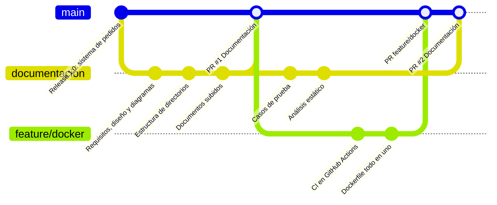

# Método de ramificación: GitHub Flow

El equipo trabaja con **GitHub Flow**: una sola rama permanente (`main`) y ramas cortas para cada
cambio, que vuelven a `main` únicamente mediante **Pull Request** con la integración continua
en verde.

## Por qué GitHub Flow

| Criterio | GitHub Flow | Git Flow |
|---|---|---|
| Ramas permanentes | Solo `main` | `main` + `develop` (+ `release/*`, `hotfix/*`) |
| Tamaño del equipo | Pequeño (3–4 personas) ✔ | Equipos grandes con varias versiones en paralelo |
| Entregas | Continuas: `main` siempre desplegable ✔ | Por versiones planificadas |
| Complejidad | Baja ✔ | Alta |

El proyecto tiene un solo release (1.0), un equipo pequeño y despliegue continuo en Vercel, por
lo que un flujo con menos ramas reduce errores de integración y es más fácil de seguir.

## Reglas

1. **`main` siempre es estable y desplegable.** Nadie hace commits directos en `main`.
2. Todo cambio nace en una rama creada desde `main`, con un prefijo según su tipo:

   | Prefijo | Uso | Ejemplo |
   |---|---|---|
   | `feature/` | Nueva funcionalidad o infraestructura | `feature/docker` |
   | `fix/` | Corrección de un defecto | `fix/total-carrito` |
   | `documentacion` | Entregables escritos del curso | `documentacion` |

3. Commits pequeños, con mensaje en español que diga *qué* cambió (por ejemplo,
   «CI: lint, tipos, pruebas con cobertura y build en GitHub Actions»).
4. Se abre un **Pull Request** hacia `main`. GitHub Actions ([`.github/workflows/ci.yml`](../.github/workflows/ci.yml))
   ejecuta automáticamente: lint (ESLint), verificación de tipos (TypeScript), pruebas con
   cobertura (Vitest, mínimo 80 % en dominio y aplicación) y compilación (`next build`).
5. Un compañero revisa el Pull Request. Con la CI en verde y la aprobación, se hace *merge*.
6. Tras el *merge*, la rama se elimina y `main` se despliega.

## Ciclo de un cambio

```bash
git checkout main
git pull                                  # partir de la última versión
git checkout -b feature/nombre-corto      # 1. crear la rama
# ... editar, probar con npm test ...
git add -A
git commit -m "Descripción del cambio"    # 2. commits pequeños
git push -u origin feature/nombre-corto   # 3. subir la rama
# 4. abrir el Pull Request en GitHub → CI → revisión → merge
git checkout main && git pull             # 5. actualizar main
git branch -d feature/nombre-corto        # 6. borrar la rama local
```

## Cómo se aplicó en el Release 1.0



| Rama | Contenido | Integración |
|---|---|---|
| `main` | Código estable del sistema (Next.js + Supabase) | — |
| `documentacion` | Requisitos, diseño, diagramas, casos de prueba, análisis estático, manuales | Pull Requests #1 y #2 |
| `feature/docker` | Integración continua (GitHub Actions), Dockerfile, README | Pull Request a `main` |

## Protección de `main` (recomendado)

En GitHub → *Settings → Branches → Add rule* para `main`: exigir Pull Request antes de
integrar, exigir que el check **CI** pase y al menos una aprobación.
