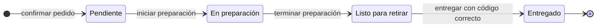

# Documentación · Release 1.0

Entregables escritos del **Sistema de Pedidos de la Cafetería Universitaria**
(Construcción y Evolución de Software · entrega 27 de noviembre de 2026).

El código estable está en la rama [`main`](https://github.com/FranciscoVilli/cafeteria-web/tree/main);
esta rama `documentacion` contiene los documentos.

## Documentos

| Documento | Word | PDF | Contenido |
|---|---|---|---|
| Requisitos | [docx](Documentacion_Requisitos.docx) | [pdf](Documentacion_Requisitos.pdf) | Alcance, supuestos (SUP-01 a SUP-17), reglas de negocio, historias de usuario HU-01 a HU-11 con criterios de aceptación, requisitos no funcionales |
| Diseño | [docx](Documentacion_Diseno.docx) | [pdf](Documentacion_Diseno.pdf) | Tecnologías, arquitectura en capas, estructura, datos, funciones SQL, contratos, pantallas, mensajes, algoritmos y seguridad |
| Diagramas | [docx](Documentacion_Diagramas.docx) | [pdf](Documentacion_Diagramas.pdf) | 13 diagramas UML: dominio, estados, componentes, despliegue, clases, errores, actividades PN-01/PN-02, secuencias y entidad-relación |
| Ambiente de desarrollo | — | — | *Pendiente* |
| Documentación técnica (TypeDoc) | — | — | *Pendiente* |
| Reporte de análisis estático | — | — | *Pendiente* |
| Casos de prueba y resultados | — | — | *Pendiente* |
| Manual de instalación | — | — | *Pendiente* |
| Manual de usuario | — | — | *Pendiente* |

## Diagramas

Las fuentes están en [`diagramas/`](diagramas/): un archivo `.mmd` (Mermaid) por diagrama y su imagen `.png`.
GitHub dibuja Mermaid directamente; para editarlos también puede usar <https://mermaid.live>.
El diagrama de componentes es una página HTML (`componentes.html`).

Ejemplo, estados del pedido:



**Volver a exportar las imágenes** (requiere Google Chrome):

```bash
cd docs/diagramas
npm install --no-save mermaid@11.4.1 playwright-core@1.56.1
node dibujar.mjs                                      # todos los .mmd → png/
node html2png.mjs componentes.html 03-componentes.png  # diagrama de componentes
```

## Cómo se actualiza

Siguiendo GitHub Flow: cree una rama desde `documentacion` (por ejemplo `docs/manual-usuario`), haga los
cambios y abra un Pull Request hacia `documentacion`. Si cambia un requisito o un supuesto (SUP-xx),
actualice el documento correspondiente en el mismo ciclo.
